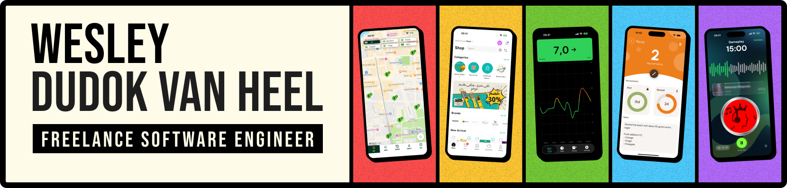

<a href="https://www.wdudokvanheel.nl">www.wdudokvanheel.nl</a> | <a href="https://www.upwork.com/freelancers/~010a4eeb4eb1e9a753">Hire me on Upwork</a> 
Over 1k billed hours | 100% Job Success rating

---

### Apps I built

- **[Bikely](https://apps.apple.com/nl/app/bikely/id1403968600)** ([Android](https://play.google.com/store/apps/details?id=no.source.safebikely)) - Bike locker rental app with 1000s of lockers across Europe.
- **[Shaghlaty](https://apps.apple.com/us/app/shaghlaty/id1487781755)** ([Android](https://play.google.com/store/apps/details?id=com.shaghlaty.ecommerce)) - Iraq's leading E-commerce app with 500k+ users.
- **[123meekijken](https://play.google.com/store/apps/details?id=nl.weseedo.app)** - Custom video call solution. 
- **[PicSolve](https://apps.apple.com/us/app/picsolve/id1663963725)** - AI camera app that solves problems from a photo.
- **[Cally](https://apps.apple.com/ua/app/cally-calorie-scanner/id6475792845)** - Calorie tracker that scans your food with the camera.
- **[King of Popquiz](https://apps.apple.com/us/app/king-of-popquiz-for-spotify/id6760858302)** - Music quiz party game for Spotify.

<!-- -->

- **[GlucoScope](https://apps.apple.com/us/app/glucoscope/id6745609594)** ([Android](https://play.google.com/store/apps/details?id=com.bitechular.glucoscope)) - Blood glucose visualizer for diabetics. [Opensource](https://github.com/wdudokvanheel/glucoscope).
- **[Kombucha Keeper](https://apps.apple.com/us/app/kombucha-keeper/id6746731068)** ([Android](https://play.google.com/store/apps/details?id=com.bitechular.kombuchakeeper)) - Track your kombucha batches. [Opensource](https://github.com/wdudokvanheel/kombuchakeeper).
- **[FlyRoads](https://apps.apple.com/us/app/flyroads/id6748967933)** - 3D runner game. [Opensource](https://github.com/wdudokvanheel/FlyRoads).
- **[Care Chords](https://github.com/wdudokvanheel/care-chords)** - Baby monitor with Spotify playback. [Opensource](https://github.com/wdudokvanheel/care-chords).
- **[Tiny Baby Care](https://github.com/wdudokvanheel/baby-care)** - Track and share your baby's sleep and feedings. [Opensource](https://github.com/wdudokvanheel/baby-care).

### Apps I work(ed) on

- **[Mjølnir](https://mjolnirapp.com/)** ([Swedish](https://apps.apple.com/us/app/mj%C3%B8lnir-swedish/id6473294617) · [Norwegian](https://apps.apple.com/us/app/mj%C3%B8lnir-norwegian/id1612479823)) - Science backed language learning app.
- **[De Buurtmarkt](https://apps.apple.com/nl/app/buurtmarkt/id6814972851)** ([Android](https://play.google.com/store/apps/details?id=com.debuurtmarkt)) - Discover and order from local food shops.
- **[Pura](https://apps.apple.com/us/app/pura-toxic-product-scanner/id6770240202)** - Scan a product for an ingredient safety score.

**My applications, tools & libraries**

- **[Aletheia](https://github.com/wdudokvanheel/aletheia)** - Fast & lightweight project browser and editor for macOS featuring a custom MD renderer.
- **[OpenAudient](https://github.com/wdudokvanheel/open-audient)** - Native macOS mixer for Audient USB audio interfaces.
- **[Neural NEAT](https://github.com/wdudokvanheel/neural-neat)** - Neural networks library that learns through evolution.
- **[rcheevr](https://github.com/wdudokvanheel/rcheevr)** - Complete RetroAchievements client rewrite in Rust.
- **[gfbmdl-rs](https://github.com/wdudokvanheel/gfbmdl-rs)**, **[gfbanm-rs](https://github.com/wdudokvanheel/gfbanm-rs)**, **[bntx-rs](https://github.com/wdudokvanheel/bntx-rs)** - Convert Nintendo Switch game models, animations and textures to standard formats.
- **[Project Stats Tool](https://github.com/wdudokvanheel/pstatool)** - Generate code statistics charts for GitHub repositories.
- **[Aseprite Installer](https://github.com/wdudokvanheel/aseprite-installer-mac)** - Build and install Aseprite on Apple Silicon Macs.

**Games & experiments**

- **[Ladderszat](https://github.com/wdudokvanheel/ladderszat)** - 2D browser platformer with custom pixel art.
- **[CHIP-8 Interpreter](https://github.com/wdudokvanheel/rust-chip8)** ([Play](https://chip8.wdudokvanheel.nl/)) - Play CHIP-8 games in the browser.
- **[Game of Life](https://github.com/wdudokvanheel/rust-game-of-life)** - Conway's Game of Life in Rust.
